# Interior Design Review & Feedback

**Project:** Apartment Interior, Vyttila, Kerala
**Client:** Mr. Sajadh
**Reference:** 2D Interior Drawings dated 02-11-2026 (19 pages)
**Date of review:** 07 November 2026

Dear Interior Design Team,

Thank you for the 2D drawings. We have reviewed all 19 pages and marked our comments directly on the drawings. This document consolidates those comments in one place so that nothing is missed. Please incorporate the changes and send us the revised drawings and an updated quotation for approval before any execution begins.

The document is organised as follows:

- **Part A** lists the changes we require. These are mandatory.
- **Part B** lists additional design suggestions. These are optional and for your consideration.
- **Part C** lists the questions and clarifications we need answered.
- **Part D** lists the deliverables and the quotation request.

## Important: Room Names Used in This Document

To stay consistent with your layout, this document uses the room names exactly as they are labelled in your drawings. Please note how they map to our actual use of the rooms (also marked on page 1):

- **Bedroom 1** is the room at the top left of the plan.
- **Bedroom 2** is our **master bedroom**. It is at the upper middle/right and has its own balcony.
- **Master Bedroom** (the label in your drawings, mid-right, above the living room) is actually our **guest bedroom**.

The original apartment layout must be preserved. Room positions, walls, doors, windows, bathrooms, both balconies and the main entrance must match the actual architectural plan.

## Part A: Required Changes

### A1. Overall Floor Plan and Foyer (Pages 1 and 6)

1. The foyer is immediately next to the main entrance door at the bottom left of the apartment.
2. Remove the chest of drawers in the foyer (page 6). Shoe storage will be outside.
3. Provide the shoe rack outside the main entrance, at the position marked on page 1.
4. Show both balconies in their correct positions.

### A2. Kitchen and Washing Area (Pages 2, 3 and 4)

1. We want to remove the wall partition between the kitchen and the washing area, subject to structural feasibility.
2. The water pipes are in the area where the washing machine has to go. Please show the washing machine position clearly, taking these pipes into account (page 4).
3. Move the mop (MOAP) storage close to the washing machine (page 3).
4. Move the cutlery, cup and saucer, and thali basket units one column to the left (page 4).
5. As noted on page 3, the roller shutter should move to the left (page 4).
6. Keep the marked space on page 4 available for a dishwasher to be installed in future if required.
7. Show the washing machine, dishwasher provision, sink, hob and refrigerator together in one revised layout before the cabinetry is finalised.
8. The washing area has more space than the drawing shows. The builder's plan (Prestige) lists the Utility as 8'0" x 4'6" (about 2.44 x 1.37 m), but the d2r plan allows only a 700 x 610 mm washing machine box. Please check the real measurements on site. Keep the wash set in the same row as the sink and hob, at the right-hand end of the run where there is enough room: a stacked washer and dryer tower with a fluted cabinet above, then a slim pull-out cabinet for the mop (MOAP) and cleaning supplies with LED shelves. The sink, dishwasher bay and hob follow in the same row.

### A3. Living Room (Pages 5, 6 and 7)

1. We will have an L-shaped sofa, and the TV unit should be the focal point of the room (page 5).
2. Move the TV unit slightly to the left if needed, so that it lines up with the L-shaped sofa (page 7).
3. Please use the wall marked on page 5 (beside the kitchen door) to showcase frames and awards.
4. Please reconsider the additional furniture and decor items in elevation D (page 7). With the L-shaped sofa there may not be enough space.

### A4. Wash Unit (Page 9)

1. The overall setup looks too simple. Please make it more attractive.
2. Add showcase shelving beside the mirror.
3. Add a covering on the left side of this area.
4. Please propose a suitable texture for the background wall.
5. Keep the mirror with back-side LED lighting.

### A5. "Master Bedroom" in the Drawings, Our Guest Bedroom (Pages 10, 11 and 12)

1. We are reusing our existing furniture in this room: a queen-size bed, two bedside tables, a dressing table with a mirror and a four-door wardrobe. We do not need a new furniture set.
2. Only the bedside lighting and the wall background design are required in this room (pages 10, 11 and 12).
3. Please plan the design around the dimensions of our existing furniture.
4. It is better to keep the loft frame and shutter, to give a proper finish (page 12).

### A6. Bedroom 1 (Pages 13, 14 and 15)

1. A bookshelf is required at the position marked on page 15.
2. Move the mirror, with its back-side LED light, next to the bedside table (page 15). Please show the revised elevation.
3. The study table stays in this room.

### A7. Bedroom 2, Our Master Bedroom with Balcony (Pages 16, 17, 18 and 19)

1. The bathroom is not positioned correctly in the drawing. Please correct it to match the actual apartment layout.
2. The balcony is missing from the layout. Please add it.
3. The bedroom entrance, bathroom and balcony must match the original architectural plan.
4. Please add a bedside table on each side of the king-size bed. The drawing currently shows none.
5. We do not need a study table in this room (pages 16 and 19). Provide a dressing table with a mirror instead.
6. Move the mirror from its current position (page 17). Place the mirror and the dressing table together as one unit.
7. Keep the dressing table modern and compact: a wall-hung desk in cream with a fluted drawer front, a rounded front end and a round boucle stool. Place it on the wall beside the bathroom door, with the mirror facing the room door.
8. Provide an oval mirror with an LED halo. Beside it, add a slim built-in niche with four shelves, each with a warm LED strip underneath, for perfumes, vases, books and a plant.

## Part B: Additional Design Suggestions (Optional)

These are suggestions only. Please advise on cost and feasibility for each.

| Area | Suggestion |
|---|---|
| Overall style | Modern, with beige and cream tones, natural wood finishes, subtle textures and warm lighting. Keep furniture and decoration minimal. |
| Foyer | A simple decorative entrance wall with warm lighting and a plain wood finish. |
| Kitchen | Beige modular cabinets with wood accents, an easy-to-maintain countertop, under-cabinet LED lighting and more vertical storage. Keep plumbing and drainage accessible. |
| Living room | A TV feature wall in wooden fluted panels with a subtle marble or textured finish, a floating TV console and concealed warm LED lighting. |
| Wash unit | Beige stone texture with wood accents and warm lighting. |
| Master Bedroom (drawing label; our guest bedroom) | A textured or upholstered headboard background, bedside wall or pendant lights and warm indirect LED lighting. |
| Bedroom 2 (our master bedroom) | A simple bed background with warm ambient lighting and a backlit dressing mirror. |

## Part C: Questions and Clarifications

Please answer the following before the drawings are finalised.

| No. | Clarification |
|---|---|
| 1 | Page 2: Is there a better way to use the space marked along the lower kitchen wall, beside the kitchen door? |
| 2 | Page 3: What is the empty (crossed) bay in kitchen elevation B? Can this unused space be put to use with a roller shutter? |
| 3 | Page 4: How will the rolling shutter look and operate? As noted on page 3, the roller should move to the left. |
| 4 | Page 4: How many burners can fit in the marked hob space? |
| 5 | Page 4: Can the marked space be reserved for a future dishwasher? |
| 6 | Can the partition between the kitchen and the washing area be removed safely? |
| 7 | Page 4: Where exactly will the washing machine go, given the position of the water pipes? |
| 8 | Page 14 (Bedroom 1, elevation A): Is one of the drawers meant to go to the left side? |
| 9 | Page 18 (Bedroom 2, elevation D): Is the wardrobe a two-piece set? |
| 10 | Please confirm all bathroom, balcony and bedroom positions against the original architectural plan. |

## Part D: Deliverables and Quotation

Before we proceed, please send us:

1. Updated 2D drawings that include all the comments above.
2. A corrected floor plan that matches the actual apartment layout.
3. Updated room-wise furniture layouts and elevations.
4. Final material, colour and laminate selections.
5. Confirmation of electrical points, lighting and plumbing requirements.
6. A revised quotation that reflects the agreed changes. Please confirm that the bookshelf, the shoe rack and the Bedroom 2 dressing table are included.

### Quotation and pricing

Please also let us know whether there is scope to negotiate the price in the original quotation. We would appreciate your best revised quotation after the agreed changes are incorporated.

## Closing Note

Our aim is a modern, elegant and practical interior that makes good use of the existing layout and reuses our current furniture wherever possible. Please review each comment carefully, update the drawings, and share the revised drawings and quotation for our approval before execution starts.

Thank you for your support.

Warm regards,
**Mr. Sajadh**

## Appendix: Design Reference (Mood and Colour Theme)

These images are for inspiration only. They show the mood, colour palette and finish we have in mind. They are not final designs and are not to scale. Please propose designs that fit our actual dimensions and layout.

### Living room

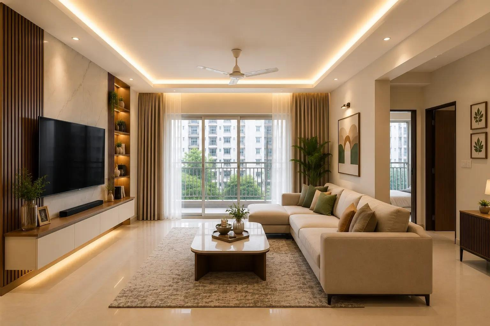

- Warm cream and ivory walls, with a light marble-finish TV wall.
- Walnut wood fluted panels beside the TV, with backlit open shelves for decor.
- Floating TV console with warm LED underlighting.
- Ceiling cove lighting and recessed spotlights.
- Beige L-shaped sofa with sage green and tan accents.

### Kitchen

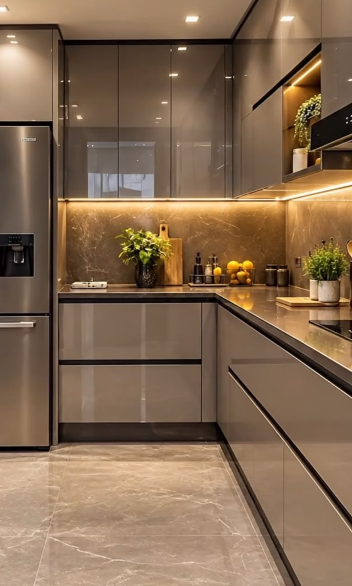

- High-gloss, handle-less cabinets in a warm grey-beige (greige) tone.
- Dark stone-look backsplash and countertop.
- Warm under-cabinet LED strip lighting and recessed ceiling lights.
- Large-format stone-look floor tiles.

### Bedroom

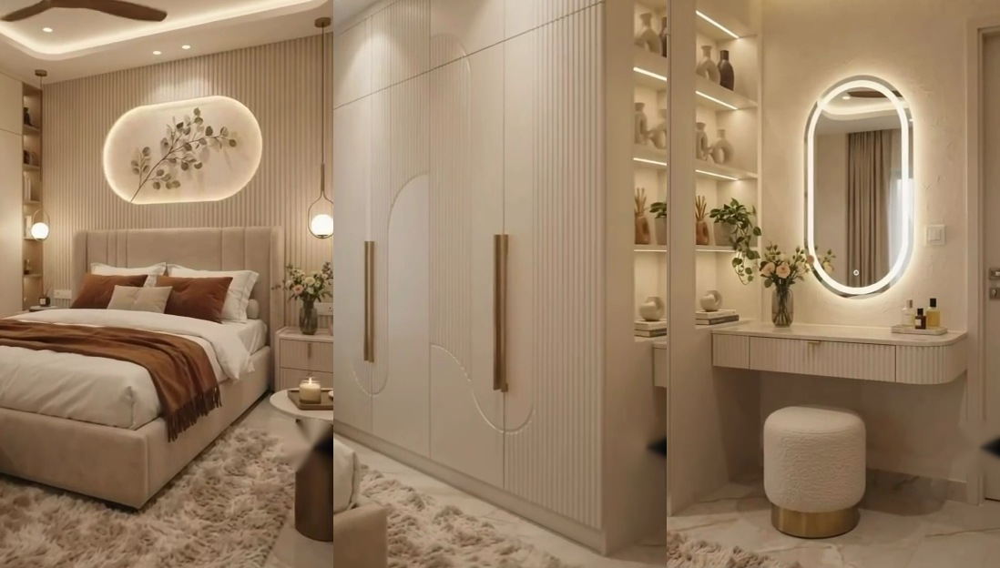

- Cream fluted wall panelling behind the bed, with a backlit decor panel and an upholstered headboard.
- Warm pendant lights on both sides of the bed.
- Floor-to-ceiling cream fluted wardrobe with slim brass handles.
- Modern floating dressing desk with a fluted drawer front and rounded end, an oval LED mirror, a slim LED-lit shelf niche beside it, and a round boucle stool with a brass base.
- Terracotta and rust accents on soft furnishings, on a beige base.

### Colour theme summary

| Element | Direction |
|---|---|
| Base colours | Cream, ivory and beige |
| Wood | Warm walnut or natural oak |
| Accents | Brass handles, soft sage green, terracotta |
| Lighting | Warm LED cove and under-cabinet lighting, pendant lights, backlit mirrors |
| Finish | Fluted panels, stone-look surfaces, minimal clutter |

## Appendix: 3D Concept Views of the Flat

These views are generated from the d2r floor plan (page 1) for visualisation only. They are a concept model, not to exact scale and not a design drawing. An interactive version is in `3d_model/Vyttila_3D_Viewer.html`.

Points for the designer to confirm: the Utility area measures about 2.44 x 1.37 m on the builder's plan, so the 3D shows the wash set at the right-hand end of the counter run, in the same row as the sink and hob: a stacked washer and dryer tower with a fluted cabinet above and a pull-out cleaning (MOAP) cabinet beside it. The kitchen/wash-area partition and the free-standing MOAP block are removed in this model.

### Whole flat (dollhouse view)

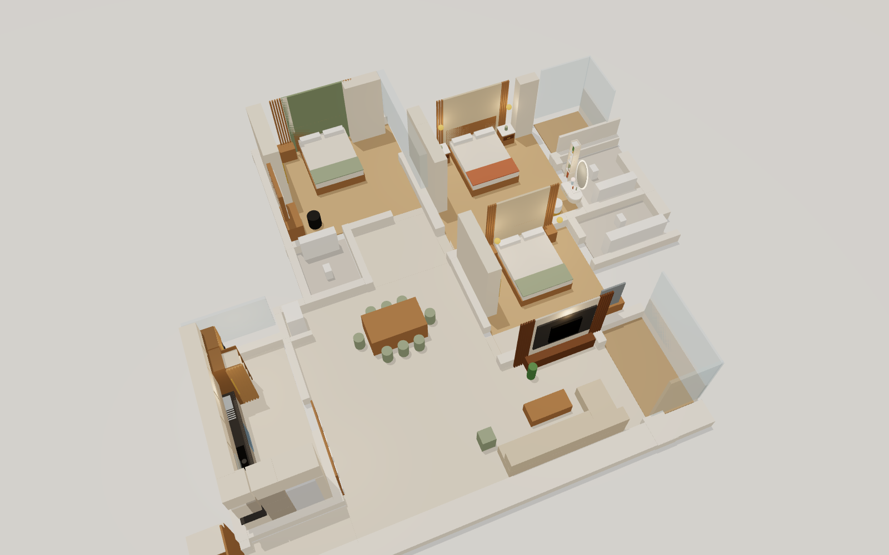

### Top view

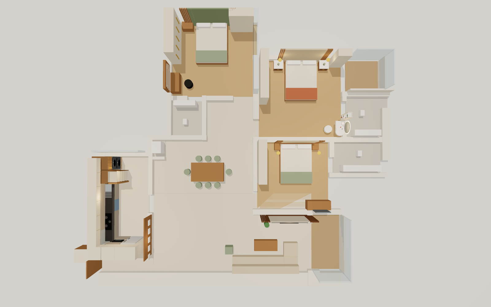

### Living room

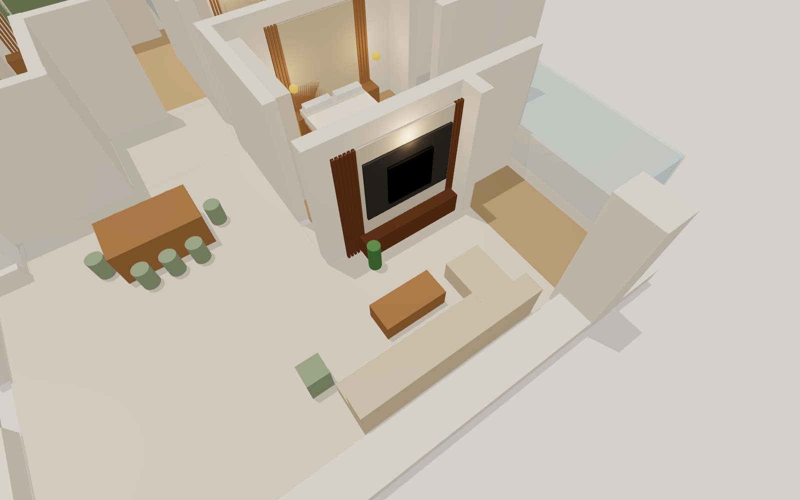

### Dining

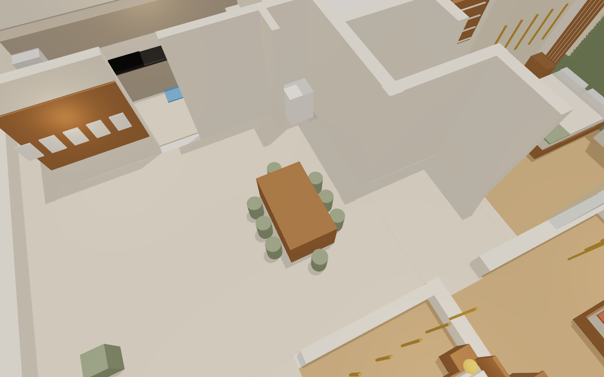

### Kitchen (counter run, fridge and washing machine)

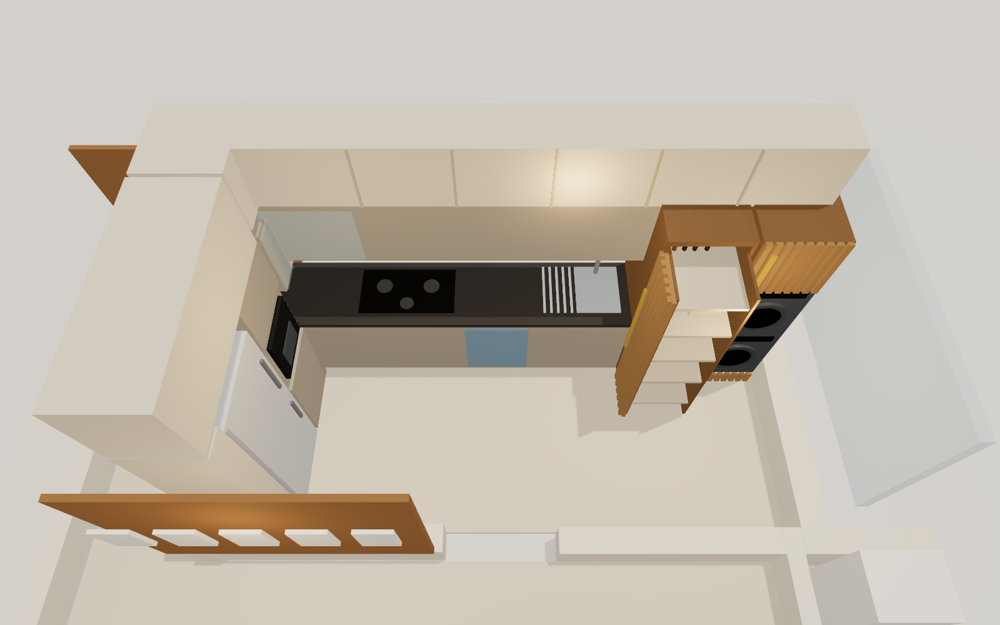

### Kitchen (fridge and oven wall)

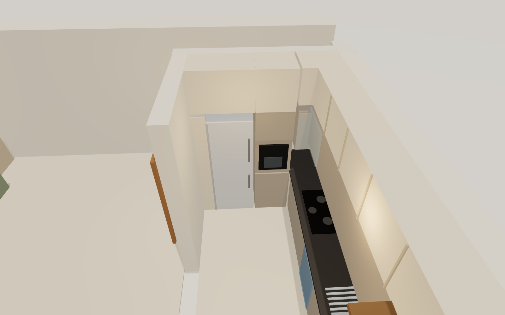

### Kitchen (wash set: washer and dryer tower, pull-out cabinet)

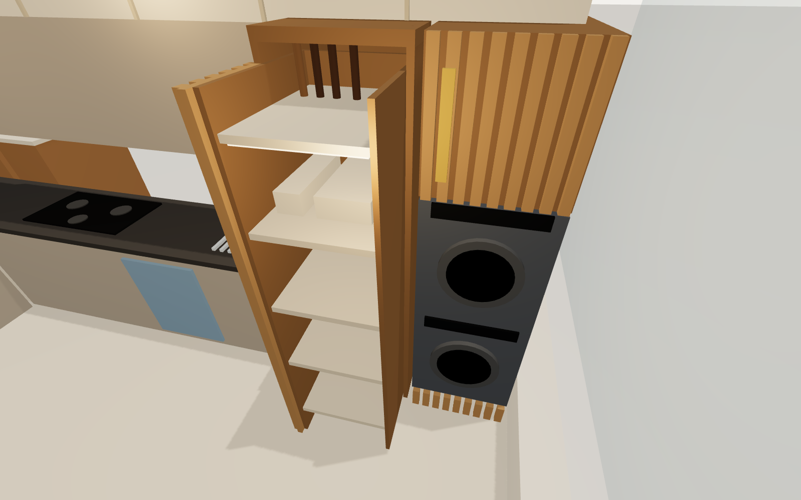

### Master bedroom (Bedroom 2)

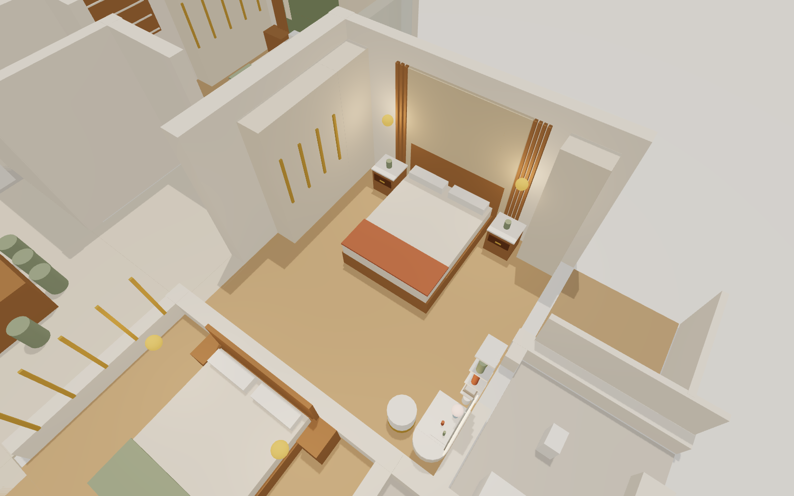

### Master bedroom (dressing table)

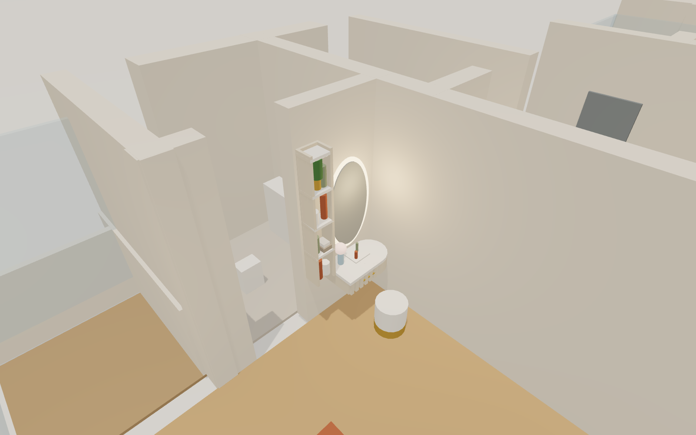

### Guest bedroom

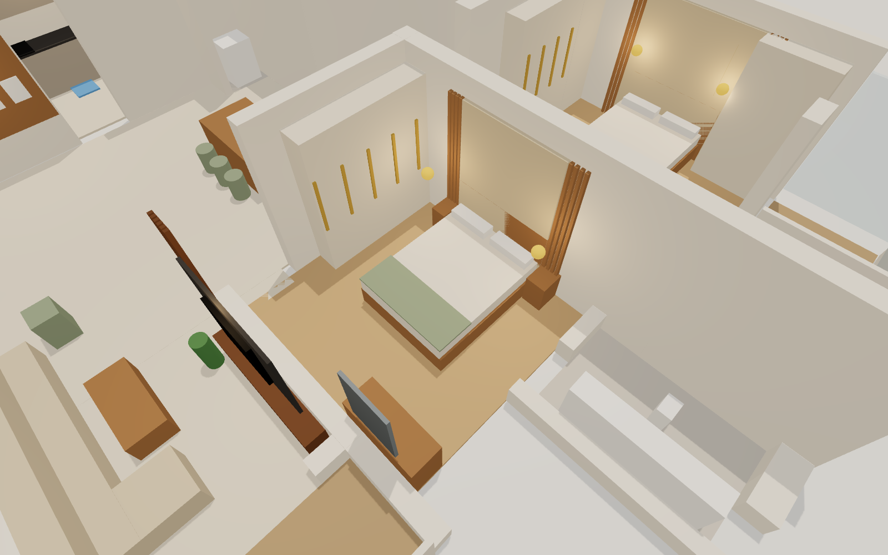

### Bedroom 1

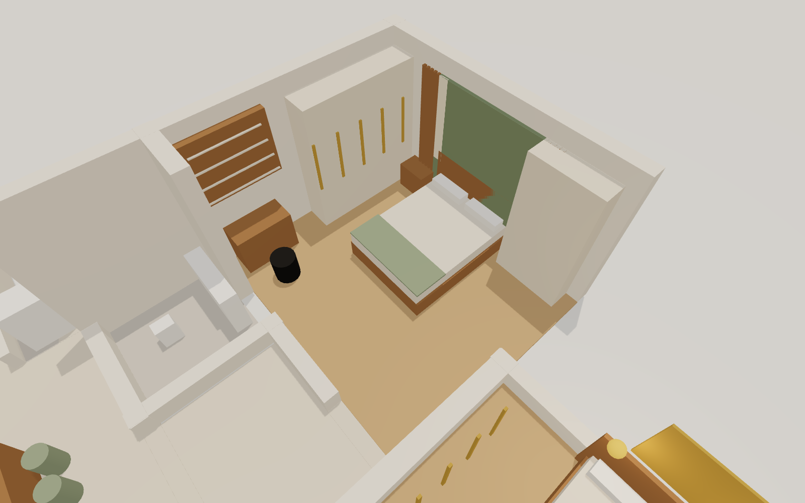
